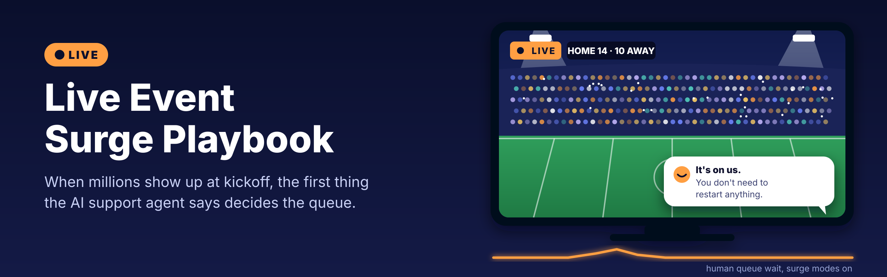
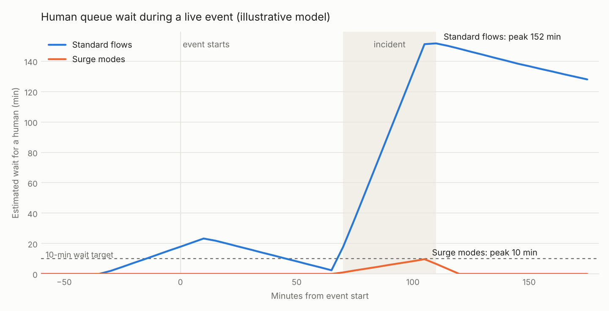

<p align="center"></p>

# Live Event Surge Playbook: AI Customer Support for Streaming Live Events

[](https://github.com/jkelleman/live-event-surge-playbook/actions/workflows/check.yml)


[](LICENSE)
[](https://github.com/jkelleman)

How an AI customer-support agent should behave when a major live event sends a huge number of members to support at once. It includes the four phases of an event, surge modes the agent switches between, five fast-path conversation flows (with diagrams), an ops runbook, a post-event review template, and a small simulator that shows how these design choices change the human queue.

> Independent portfolio project by [Jen Kelleman](https://github.com/jkelleman). Not affiliated with or endorsed by Netflix. Public figures cited below come from published reporting; everything else, including the simulator inputs, is illustrative.

---

## Why this exists

Everyday support is spread out over the day. Live-event support isn't. Thousands of members show up in the same few minutes with the same problem: they can't sign in on the TV, their payment was declined at sign-up, they can't find the event, or the stream is buffering. If something breaks on the service's side, the same thing happens again, ten times bigger.

A support agent designed only for everyday traffic fails here in a predictable way. It runs normal troubleshooting, tells millions of people to restart routers that aren't the problem, keeps them out of the event longer, and floods the human queue with contacts it can't resolve.

**This is a conversation design problem, not just a staffing problem.** What the agent says first decides whether a member gets back to the event in 30 seconds or joins a two-hour queue.

### The Netflix context

- **Live drives growth.** On the Q2 2026 earnings call, co-CEO Greg Peters said six of Netflix's top 10 new-member sign-up days in the past five years came from live events. He put live at about 5% of the content budget but only about 1% of viewing hours ([MarketBeat](https://www.marketbeat.com/instant-alerts/netflix-q2-earnings-call-highlights-2026-07-16/)).
- **Live events break records.** Netflix said the 2026 World Baseball Classic reached 31.4 million viewers, became the most-watched program ever in Japan, and drove the largest single sign-up day in Japan's history ([Q1 2026 call](https://www.fool.com/earnings/call-transcripts/2026/04/16/netflix-nflx-q1-2026-earnings-call-transcript/)).
- **Live events stress the system.** Netflix said the November 2024 Paul–Tyson fight drew 60 million households and peaked at 65 million concurrent streams. Viewers also reported widespread buffering, and Downdetector logged more than 100,000 complaints during the broadcast. CTO Elizabeth Stone acknowledged the problems in a memo to employees ([AP via Fox19](https://www.fox19.com/2024/11/16/streaming-issues-reported-height-netflixs-jake-paul-mike-tyson-fight/), [Front Office Sports](https://frontofficesports.com/netflix-cto-calls-fight-success-despite-buffering-issues)).

The takeaway for support design: **the biggest moments bring the most new members, and their first contact with support may come during the busiest, most fragile few minutes the service has.**

## What's inside

```
playbook/phases.md          pre-event · kickoff rush · main event · after
config/surge-modes.yaml     normal · elevated · surge · incident, and what changes in each
flows/
  sign-in-at-kickoff.md     phone-first sign-in; "watch on your phone now, fix the TV later"
  new-member-payment.md     declined at sign-up; protected human lane; no card data in chat
  cant-find-the-event.md    one-turn answer; region rules; no hard sell
  live-buffering.md         the big one: no troubleshooting during a declared incident
  after-the-event.md        callbacks first; replays; goodwill as policy, not improvisation
docs/runbook.md             roles, T-7d → T-60m checklists, mode triggers, incident templates
docs/post-event-review.md   blameless review template
scripts/simulate_surge.py   toy queue model: standard flows vs. surge modes
config/sim-assumptions.yaml the model's illustrative inputs
```

## Surge modes

The agent reads the current mode at the start of every conversation. A person switches modes; the dashboard only recommends.

| | normal | elevated | surge | incident |
|---|---|---|---|---|
| **When** | everyday | event window open | volume far above capacity | confirmed problem on our side |
| **Troubleshooting** | full | 1–2 steps | 1 step max | **none** |
| **Banner** | off | event help | event help | incident message, every locale |
| **Retention offers** | one, if relevant | off | off | off |
| **Human handoff** | standard | standard | protected lane* | protected lane* |
| **Callback offer** | — | — | yes | yes |

\* Safety signals, payment failures, and a member's second request for a person always reach a human immediately, in every mode.

## The simulator

```bash
pip install pyyaml matplotlib
python scripts/simulate_surge.py --chart docs/surge-sim.png
```

```
ILLUSTRATIVE MODEL - assumptions in config/sim-assumptions.yaml

                                standard   surge modes
Total contacts                    22,378        20,295
Sent to live human queue          12,470         5,048
Deferred to callback                   0         1,776
Peak queue backlog                 5,463           348
Peak est. wait (min)               151.7           9.7
Minutes with wait > 10               170             0
```



**The numbers are made up, but the shape is the argument.** With standard flows, the kickoff rush builds a queue that hasn't cleared when the incident hits. Troubleshooting can't fix an outage on the service's side, so members fail, try again, and the repeat contacts compound. With surge modes, three design choices do most of the work:

1. **Known issue first.** "It's on us, you don't need to do anything" resolves the contact. A router restart doesn't.
2. **Fast paths at kickoff.** Phone-first sign-in and "watch on your phone now" get members to the event instead of into a queue.
3. **Callbacks.** Members who don't need help *right now* get it after the event, which keeps the live queue for the cases that do.

Swap in real contact data and containment rates to use the model for staffing and design decisions.

## Executive summary

**Problem.** Live events concentrate a huge number of support contacts into minutes, many from brand-new members. An agent designed for everyday traffic sends them through troubleshooting that can't help during an outage, and the human queue collapses.

**Approach.** Four surge modes that change what the agent says and does, five fast-path flows built for the kickoff rush and main event, incident messages approved in every locale before the event, and an ops runbook that keeps mode changes a human decision.

**What it enables.**
- Members hear "it's on us" in the first turn during an incident, in their language.
- The human queue stays open for payment failures, safety issues, and members who ask for a person.
- New members' first support experience is fast and honest, at the moment it matters most for retention.

## Companion repos

- [support-agent-pattern-library](https://github.com/jkelleman/support-agent-pattern-library): `proactive-known-issue`, `escalate-to-human`, and the other patterns these flows use
- [golden-dataset-kit](https://github.com/jkelleman/golden-dataset-kit): includes labeled failures like `ignored_incident_context`
- [multilingual-voice-guide](https://github.com/jkelleman/multilingual-voice-guide): `known_incident` written for every launch locale

## License

MIT. See [LICENSE](LICENSE).
