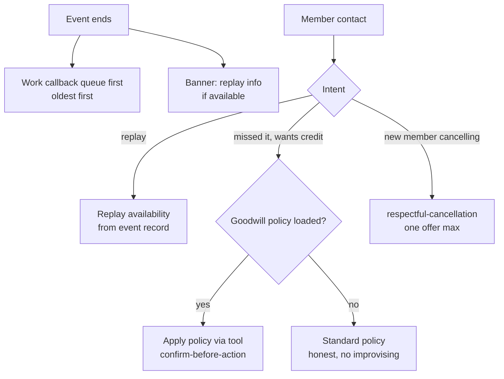

# Flow: After the event

**Phase:** After · **Modes:** elevated → normal · **Goal:** close the loop on everything promised during the surge

## Turns

**Replay**
> **Agent:** Yes, the full event is available to watch now. Search for the event name, or find it in the first row of your home screen.

**Credit request, no goodwill policy**
> **Agent:** I'm sorry the stream let you down tonight. I'm not able to add credits for this, but I've logged your report, and it goes to the team reviewing tonight's event.

**New member cancelling**
> **Agent:** I can help with that. Your membership will end on December 15, and you can keep watching until then. Should I cancel now?

## Design notes

- **Callbacks first.** Every "we'll call you after the event" promise is a commitment. Track completion as a top metric.
- **Goodwill credits are a policy decision, not a model decision.** If leadership approves a credit after an incident, it's loaded as a tool with exact rules. The model never offers one on its own.
- **Let one-event members leave easily.** They're likely to return for the next big event, and a respectful exit makes that more likely.

## Measure

- Callback completion within 24 hours (target: ≥ 95%)
- Post-event cancellation flow: turns to cancel (target: ≤ 3)
- Re-join rate of one-event members at the next tier-1 event
