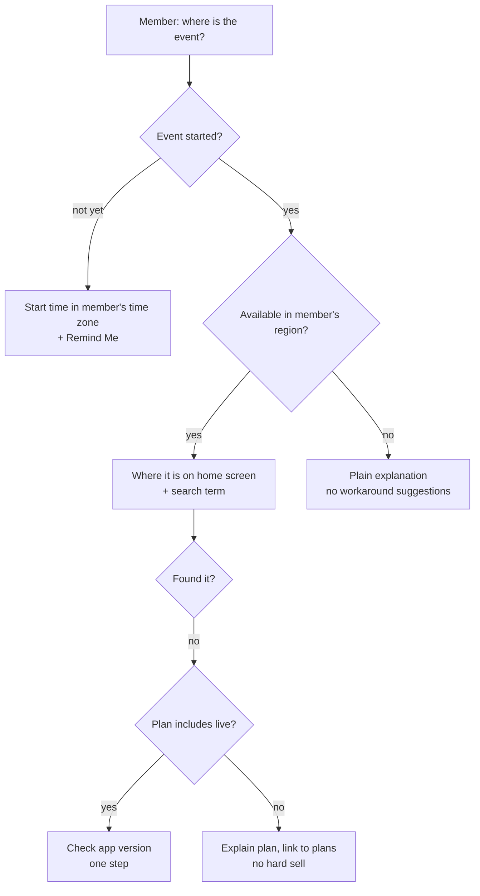

# Flow: Can't find the event

**Phase:** Kickoff rush · **Modes:** elevated, surge · **Goal:** member on the event page in one turn

## Turns

**Before start**
> **Agent:** It starts at 8:00 PM your time, about 25 minutes from now. Search for the event name, or tap Remind Me on its page and we'll notify you when it starts.

**Not available in region**
> **Agent:** This event isn't available in your country, so it won't appear in your app. I'm sorry I can't change that.

## Design notes

- **Region availability:** state it plainly from the rights record. Never hint at workarounds.
- **"Is it included in my plan?"** comes from the plans API. If the answer is "no," explain once and link to plans. No pressure language at kickoff.
- **Search term:** give the exact title as it appears in the app in the member's locale, from the event record.

## Measure

- One-turn resolution rate (target: ≥ 80%)
- "Not available in region" contacts, by country (feeds the event FAQ and banner)
