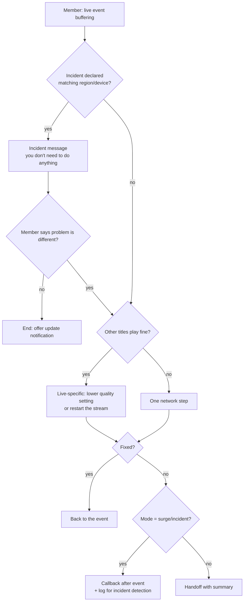

# Flow: Live event buffering

**Phase:** Main event · **Modes:** surge, incident · **Goal:** member back to watching, or told honestly that it's on us

This is the flow that matters most. During a large live event, a stream problem on our side can bring a huge number of members to support at the same moment. If the agent responds with standard troubleshooting, it sends all of them to restart routers that aren't the problem, keeps them out of the event longer, and makes them blame their own internet.

## Turns

**Incident declared**
> **Agent:** We're having a problem with the live stream right now that's affecting some members in your area. It's on our side, and our team is working on it. You don't need to restart anything. Want a notification when it's fixed?

**No incident, one step**
> **Agent:** Let's try one quick thing so you don't miss more: back out of the event and start it again. If it's still buffering, I'll log it right away.

**Problem is different**
> **Agent:** Thanks for telling me. Let's look at your problem specifically. Do other shows play fine on that TV?

## Design notes

- **No troubleshooting during a declared incident.** This is the single most important rule in the playbook.
- **Say "it's on us."** Members can handle a problem; what erodes trust is being told to fix something that was never theirs to fix.
- **Unresolved contacts are a signal.** When many members in one region or on one device type report buffering and no incident is declared yet, those reports should reach the incident team. Support conversations are often the earliest detector.
- **Don't promise an ETA** unless the incident record has one.

## Measure

- Troubleshooting started while a matching incident was active (target: 0)
- Time from incident declared to incident message live in every locale (target: < 5 minutes)
- Repeat contacts during the incident window
