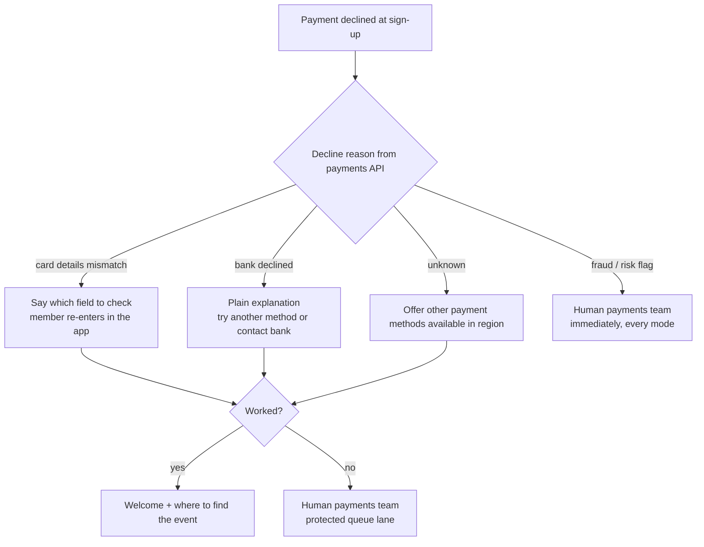

# Flow: New member, payment failed

**Phase:** Kickoff rush · **Modes:** elevated, surge · **Goal:** a working membership before kickoff, without the agent ever touching card details

A member signing up to watch tonight's event has their payment declined. They are not yet a member, they're under time pressure, and this conversation is their first impression of the brand.

## Turns

**Bank declined**
> **Agent:** Your bank declined the payment. That's on their side, and it happens sometimes with new online charges. You can try another card or payment method in the app, or ask your bank to allow it.

**Success**
> **Agent:** You're all set. Welcome! The event is on your home screen and starts at 8:00 PM.

## Design notes

- **The agent never collects card numbers in chat.** Members re-enter details in the app's payment form. See `verify-before-sensitive-info`.
- **Payment failures get a protected lane** in the human queue even in surge mode. A member who can't pay can't watch, and a human may be the only way through.
- **Decline reasons come from the payments API.** The model never guesses why a card was declined.
- **Welcome them.** The success turn is the first thing a new member hears from the brand. Make it warm and useful.

## Measure

- Sign-up recovery rate after a decline
- Time to recovery (target: before kickoff)
- Card data in chat logs (target: 0)
