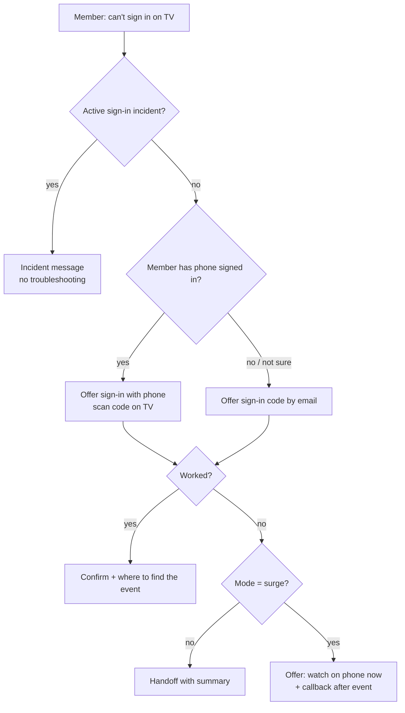

# Flow: Sign-in at kickoff

**Phase:** Kickoff rush · **Modes:** elevated, surge · **Goal:** member watching on their TV before the event starts

Many members haven't signed in on their TV in months, or are signing in on a new device for the first time. Typing a password with a TV remote at T-5 minutes is the worst version of sign-in.

## Turns

**Opening (no incident)**
> **Agent:** Let's get you in fast. Is your phone signed in? If so, you can sign in on the TV by scanning the code on screen. No typing.

**After success**
> **Agent:** You're in. The event is on the home screen in the first row. It starts at 8:00 PM.

**Fallback in surge mode**
> **Agent:** That didn't work, and I don't want you to miss the start. You can watch on your phone right now. I can also have someone call you after the event to fix the TV. Want me to set that up?

## Design notes

- **Phone-first sign-in** avoids remote-control typing, the slowest step. Offer it before password reset.
- **Never start with "reset your password"** at kickoff. It sends an email, adds a step, and fails if the member can't access that inbox.
- **Watch somewhere else now, fix later** is the surge fallback. The member's goal is to see the event, not to fix the TV.
- Start time comes from the event record, in the member's time zone.

## Measure

- Time from first message to signed in (target: under 2 minutes)
- Share of members offered phone sign-in first (target: 100% where eligible)
- Callbacks completed within 24 hours
